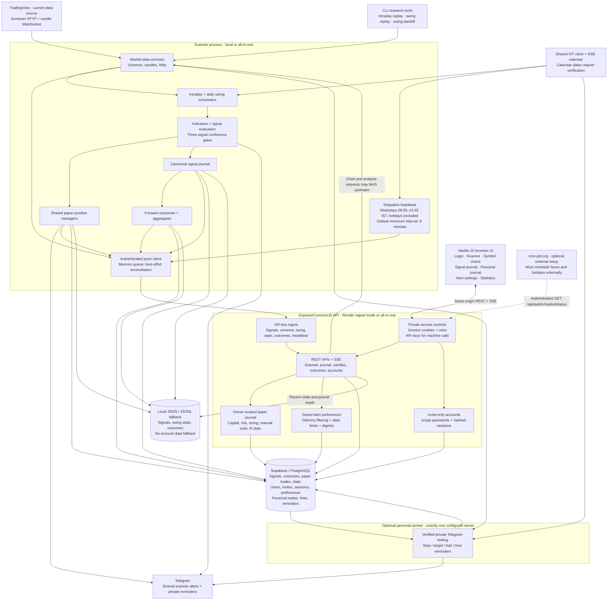

# AnkQuant — current architecture

Snapshot: 29 October 2026. Describes the implemented `work` checkout, including uncommitted changes. Production deployment, applied migrations and live integrations have not been verified.

## Deployment shapes

- **All-in-one:** one process serves the API/UI and runs enabled scanner/evidence loops.
- **Split:** a scanner with working TradingView access pushes to the hosted API. `INGEST_MODE=true` disables scanner/evidence startup on the hosted instance. Candle and some analysis endpoints can still request upstream data.
- The personal worker is independently enabled with `ENABLE_PERSONAL_WORKER=true`; run exactly one Telegram consumer with database and market-data access. It may run on the scanner host.
- The keepalive gate controls heartbeat traffic only. Normal pushes, background work and user visits are separate. An external pinger must exclude holidays before sending requests; the application cannot prevent an already-sent incoming request.

## Storage and access

Market history uses optional Supabase persistence plus documented local fallbacks; not every quote/candle is durably cached. Account identity, sessions, preferences, personal trades and reminder delivery require Supabase and fail closed without it. All database secrets stay on the backend. Personal ownership comes from the session, never a browser-supplied user ID. Machine keys do not impersonate personal users.

The UI service worker caches static assets only, not authenticated HTML/API responses. Scanner favourites are browser-local; account alert watchlists are separately stored preferences.

## State of the roadmap

| Phase | Current state |
| --- | --- |
| 0: Correctness | Implemented; official calendar verification remains |
| 1: Evidence | Implemented; live provider/database checks remain |
| 2: Accounts | Foundation implemented with Phase 4; live migration/account checks remain |
| 3: Per-user signal alerts | Implemented: filtering, digests, private controls and admin heartbeat alerts; live database/Telegram verification remains |
| 4: Personal paper journal | Implemented; live Telegram/database checks remain |
| 5: UI | Implemented; fixture browser flow verified; live integration/full accessibility audit remain |
| 6: Reliability | Partial: scheduled keepalive exists; durable outbox, replica ownership, broader validation/logging/metrics/backup/shutdown hardening remain |
| 7: CI and load testing | Implemented Actions, Playwright, contracts and 50-client SSE regression; remote/staging execution remains unverified |
| 8: Upstox migration | Proposed only; TradingView remains active |

No broker orders, automated trading or cross-user leaderboards are implemented. Test results from earlier work establish local/fixture behavior, not production deployment state. This snapshot involved source inspection and documentation checks only; no new application tests or deployment actions were performed.
