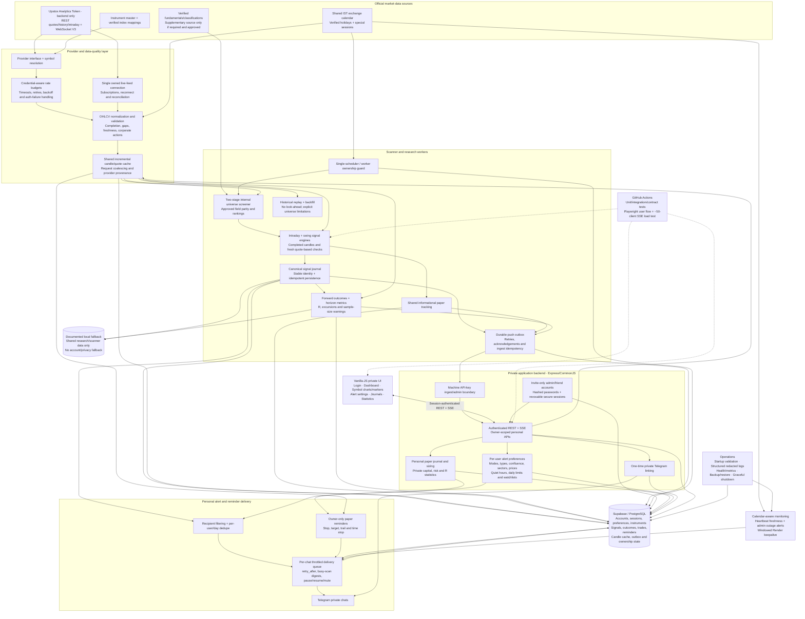

# AnkQuant — target architecture after the planned phases

**TARGET DESIGN — not a statement of current deployment or completed work.**
This consolidates Phases 0–8, including unfinished work and the proposed Upstox migration.
See ARCHITECTURE.md for the current implementation.

## Final scope by phase

| Phase | Target deliverable |
| --- | --- |
| 0 — Correctness | Consistent completed candles, one verified exchange calendar, injected clocks, accurate schedules and documentation |
| 1 — Evidence | Per-signal forward outcomes, conservative stop-first assumptions, horizon returns/excursions, grouped statistics with n warnings, swing replay without look-ahead |
| 2 — Users | Invite-only admin/friend identities, safe passwords/sessions, login throttling and database-backed owner isolation |
| 3 — Alerts | Enforced personal preferences, verified Telegram links, per-chat delivery controls, digests, dedupe, pause/resume/mute and admin stale-heartbeat notifications |
| 4 — Personal paper journal | Take a signal with personal levels/quantity or risk sizing; owner-only reminders, manual exits and private R statistics; no leaderboards |
| 5 — UI | Accessible mobile-first vanilla-JS login, dashboard, symbol chart/markers, alerts, journals and statistics with loading/empty/error states |
| 6 — Reliability | Durable outbox, idempotent signal ingestion, single scheduler/worker ownership, config validation, structured logs/metrics, backups, shutdown and scheduled keepalive |
| 7 — Tests and CI | GitHub Actions, contract tests, Playwright login → preferences → journal flow, and approximately 50 concurrent SSE clients |
| 8 — Upstox data migration | Official instruments/REST/streaming, internal screening with explicit field parity, shared provider-aware cache, budgeted requests, staged validation and controlled cutover/rollback |

## Deployment target

Keep one codebase with two supported shapes:

- **All-in-one:** one service runs the private API/UI and owns enabled scanner/feed/delivery workers. Start here if the chosen host's resource budget and Upstox connectivity are verified.
- **Split:** dedicated scanner/feed workers send through the durable outbox to the hosted API. Browser/API requests share the market-data cache/service instead of repeatedly downloading history. Ownership guards prevent duplicate scanners and bot consumers.

The design does not require Redis, Kubernetes, paid queues or microservice proliferation.
Use Supabase-backed coordination and durable state where appropriate, then measure whether
additional infrastructure is needed. Any paid change requires prior approval.

Keepalive requests are restricted to configured weekday IST hours and calendar dates.
An external pinger must exclude holidays before sending requests. Windowed keepalive
is not an uptime guarantee; monitoring reports real stale/outage state without sending
repeated notifications for an unchanged incident.

## Boundaries and conditions

- Market data, alerts and paper tracking only; no broker orders or automated trading.
- Upstox tokens remain on the backend. Friends authenticate to AnkQuant, not to the broker token.
- Verify permissions/entitlements for the intended multi-user data display and alerts before rollout.
- Full TradingView screener parity is a feasibility gate, not a promise: fundamentals, sectors,
  relative-volume definitions, corporate actions and missing fields need verified sources/formulas.
- Upstox becomes default only after authenticated staging checks and explicit production approval.
  TradingView is retained only for an approved rollback/fallback window, never silently mixed.
- Provider-specific candle identity and provenance keep history/evidence interpretable.
- Personal data requires the database and fails closed. File fallbacks apply only to documented
  shared scanner/research paths and must never bypass account isolation.
- Real live-data checks, migration execution and production deployment must be reported separately
  from fixture/unit/browser-test success.

## Suggested completion order

1. Verify account/database migrations and calendar data on staging.
2. Finish Phase 3 preference enforcement and private signal delivery.
3. Complete the Phase 6 durability/ownership/backup foundations and Phase 7 automation.
4. Execute Phase 8A feasibility; proceed through REST, screening, streaming and staged cutover.

Phase 8 feasibility may run earlier because it can expose data-source limitations before
implementation. The final Upstox cutover depends on the relevant correctness and reliability gates.
