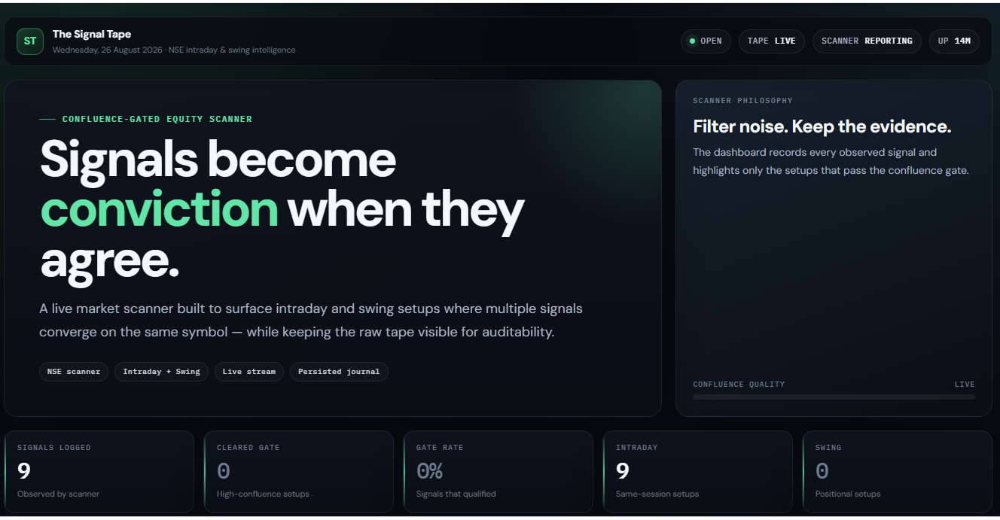
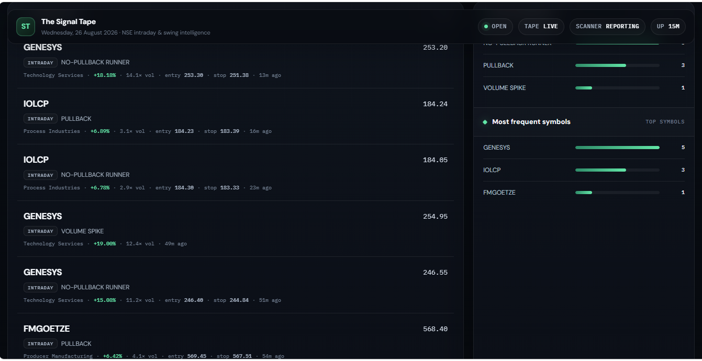
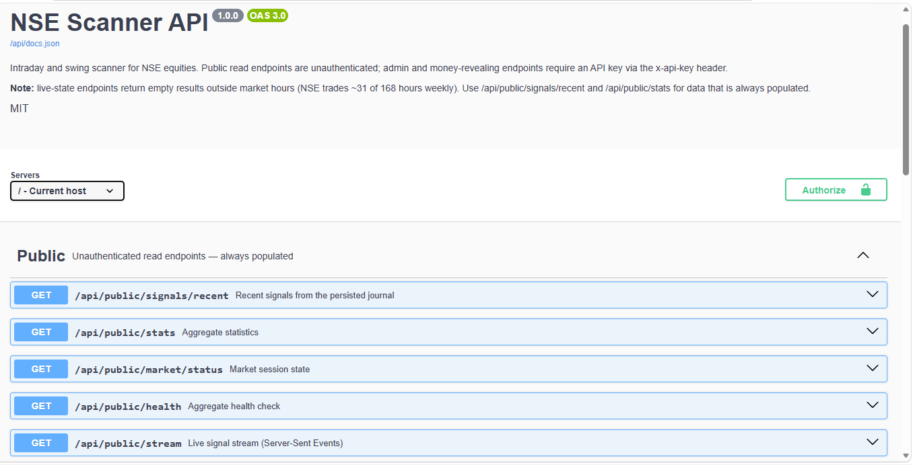

# AnkQuant

A production-style Node.js + Express market intelligence platform for detecting intraday and swing trading setups using technical indicators, price action, and configurable market conditions.

## Screenshots

### Live Scanner Dashboard



### Signal Tape & Confluence Detection



### APi Docs



A market scanner for NSE equities with two independent modes sharing one
codebase:

- **Intraday** — polls a live universe of high-relative-volume stocks every
  15–30s, evaluates seven 5-minute-timeframe signals per symbol, and sizes a
  position only when multiple signals agree. Flat by 15:15.
- **Swing** — runs once daily after the close (15:45 IST by default), evaluates
  six daily-timeframe signals across a structurally-filtered universe, and
  tracks multi-day positions with ATR-based stops and R-multiple targets.

Originally a Python/Colab notebook, rewritten as an Express service.

---

## Why two modes and not one

They are not the same strategy on different timeframes — they disagree on
almost every parameter, and the disagreements are the interesting part:

|                     | Intraday                                   | Swing                                            |
| ------------------- | ------------------------------------------ | ------------------------------------------------ |
| **Candles**         | 5-minute                                   | Daily                                            |
| **Universe filter** | Already moving (change > 2%, rel vol > 2x) | _Not_ extended today (change < 5%), above 200DMA |
| **Poll cadence**    | 15–30s tick loop                           | Once daily, after the close                       |
| **Stop basis**      | Fixed points / structural level            | ATR-scaled (2× ATR14), tightened to structure    |
| **Target**          | Fixed +10 points                           | 2.5R                                             |
| **Trail**           | 1.5% from peak                             | Chandelier (peak − 2.5× ATR)                     |
| **Confluence gate** | 3+ signals                                 | 3+ signals                                       |
| **Time limit**      | Square-off at 15:15                        | Time stop at 15 sessions under 1R                |
| **State**           | In-memory, wiped daily                     | Persisted to disk                                |

Two of those deserve explanation:

**The universe filters are near-opposites.** The intraday scan wants stocks
already in motion. For a swing entry that's exactly backwards — a stock up 6%
today is a _bad_ swing entry, because your stop now sits far below and your
risk-per-share is inflated by the move you missed. So the swing screener
explicitly excludes stocks up more than 5% on the day.

**Both confluence gates require three signals.** Swing entry confluence also requires a structural entry/stop signal. Contextual uptrend signals alone cannot define a paper entry.

---

## Intraday signals

| Signal                 | Condition                                                                      | Provides a stop?        |
| ---------------------- | ------------------------------------------------------------------------------ | ----------------------- |
| **Pullback**           | Uptrend (EMA9 > EMA20), price within 0.3% of EMA9, green candle, rising volume | Yes — below EMA9        |
| **ORB breakout**       | Clears the 9:15–9:45 opening range high                                        | Yes — opening range low |
| **No-pullback runner** | Above EMA9/VWAP for 8+ bars without touching EMA9                              | Yes — below EMA9        |
| **Afternoon breakout** | ~2h base within 2% range, broken on 3× volume                                  | Yes — old base high     |
| **Momentum**           | Price / change% / rel volume all rising across 5 cycles                        | No                      |
| **Volume spike**       | Current bar ≥ 3× the prior 5-bar average                                       | No                      |
| **VWAP reclaim**       | Cross back above VWAP on ≥1.5× average volume                                  | No                      |

## Swing signals

| Signal            | Condition                                                | Provides a stop?       |
| ----------------- | -------------------------------------------------------- | ---------------------- |
| **Base breakout** | 20-day base within 12% range, broken on 1.8× base volume | Yes — base low         |
| **MA pullback**   | Pullback into EMA20/EMA50 with trend intact, ≤15% deep   | Yes — recent swing low |
| **MA stack**      | Price > EMA20 > EMA50 > EMA200, all rising               | No                     |
| **52W high**      | Within 5% of the 52-week high                            | No                     |
| **Volume dry-up** | Recent 5-day volume ≤70% of the prior base average       | No                     |
| **RS leader**     | 60-day return beats the index's                          | No                     |

In both modes, signals without a natural stop level contribute to the
confluence count but can't define an entry on their own.

---

## Position management

Sizing is capped by three independent ceilings in both modes — max rupee risk
per trade, total allocated capital, and capital already deployed — so combined
exposure can't exceed the limit. Swing adds a fourth: a hard cap on concurrent
open positions, because five positions each risking the full per-trade budget
is a much larger drawdown exposure than the capital figure alone suggests.

**Intraday lifecycle:** stop hit → full exit. Target (+10pts) → book half, stop
to breakeven, trail the rest at 1.5% from peak. Anything still open at 15:15 →
force-exit.

**Swing lifecycle:** stop hit → full exit. Target (2.5R) → book half, stop to
breakeven. Runner trails chandelier-style at peak − 2.5× ATR, which widens with
volatility instead of using a fixed percentage — a 1.5% trail on a daily chart
would stop out on ordinary noise. Positions still under 1R after 15 sessions
are cut by the time stop, since dead capital in a swing book is a real cost in
a way it isn't intraday.

**Both are calculators, not broker connections.** They tell you what to do; you
place the orders.

---

## Architecture

```
src/
  config/
    constants.js          Intraday tunables
    swingConstants.js     Swing tunables — deliberately separate, since the
                          two strategies share almost no numbers
    timeUtils.js          IST-aware time helpers
  services/
    tvScanner.js          Intraday scan universe
    swingScanner.js       Swing scan universe (different filters entirely)
    tvHistory.js          Historical OHLCV candles (websocket client)
    telegram.js           Alerts + /command polling for both modes
    supabaseStore.js      Server-only persistent storage adapter
    paperTradeStore.js    Persists trade lifecycle and restores today's positions
    nifty.js              Cached index change for the intraday RS gate
    eventStream.js        SSE broadcaster with heartbeat + reconnect support
    marketStatus.js       Session phase, holidays, next open
    pushClient.js         Forwards universe snapshots, signals, and positions to a remote instance
  indicators/
    ta.js                 EMA / session-resetting VWAP
    swingTa.js            ATR (Wilder), SMA, RSI, rolling high/low
    signals.js            Seven intraday signal evaluators
    swingSignals.js       Six daily signal evaluators
  trading/
    positionManager.js       Intraday: fixed-point targets, square-off
    swingPositionManager.js  Swing: ATR stops, R-multiples, time stop
    momentum.js              Cross-cycle momentum history
    volume.js                Volume explosion detection
  state/
    dailyState.js         Intraday scan state — in-memory, reset daily
    swingState.js         Swing state — Supabase with local-file fallback
    signalJournal.js      Signal journal — Supabase with JSONL fallback
  jobs/
    scanLoop.js           Intraday cycle — tiered 15–30s polling
    swingLoop.js          Swing cycle — once daily after the close
  backtest/
    backtest.js           Bar-by-bar replay of intraday logic, no look-ahead
  routes/
    scanner.js            Intraday REST API
    swing.js              Swing REST API
    public.js             Unauthenticated read API + SSE
    ingest.js             Authenticated push endpoint for a remote scanner
  middleware/
    auth.js               API key auth, rate limiting, money redaction
  docs/
    openapi.js            OpenAPI 3.0 spec + Swagger UI page
  server.js
  index.js                Starts HTTP server + both loops
public/
  scanner.html            Daily-use intraday scanner workspace at /app
  journal.html            Searchable signal history and CSV export at /journal
  demo.html               Public signal tape at /demo; no build step
Dockerfile                Non-root, tini init, health check
docker-compose.yml        api / full profiles
supabase/migrations/      SQL schema for durable signals and paper trades
test-swing.js             65 assertions — swing indicators + position lifecycle
test-api.js               79 assertions — auth, redaction, SSE, journal, errors
test-ingest.js            49 assertions — split architecture over real HTTP
```

**Stack:** Node.js, Express, Axios, WebSocket.

Design notes worth calling out:

- **Supabase is the durable store when configured.** It preserves signal
  history, swing positions, and swing trade outcomes across Render restarts.
  Local development falls back to JSONL/JSON files. Intraday live state stays
  in memory and resets daily; open intraday paper positions and trade history
  are mirrored to Supabase. A swing position is held for weeks, so losing it on
  restart could stop the scanner from managing its paper stop.
- **The swing scan runs after the close, not intraday.** Daily signals
  evaluated against a still-forming candle are simply wrong — a "breakout on
  1.8× volume" checked at 11:00 compares a third of a day's volume against
  full-day averages. This is the single most common way a daily-timeframe
  backtest silently diverges from live results.
- **The intraday loop reschedules with `setTimeout` after each cycle
  completes**, rather than firing on a fixed `setInterval`, so a slow cycle
  can't stack up behind itself.
- **Every signal evaluator fails open** — returns `null`/`false`/`0` rather
  than throwing, so one bad symbol never kills a cycle.
- **Swing fetches daily candles once per symbol per scan** and passes the
  array to all six evaluators, rather than the intraday pattern of one fetch
  per signal. At ~150 symbols × 6 signals that difference is ~900 avoided
  round-trips.
- **ATR uses Wilder's smoothing**, not an SMA of true range. The shortcut is
  common and gives visibly different values — which matters when ATR is
  setting your stop distance.
- **SSE rather than WebSocket** for the live stream. The traffic is strictly
  one-directional; SSE gets browser reconnection for free, rides plain HTTP so
  it survives proxies that mangle WebSocket upgrades, and needs no client
  library. A 25s heartbeat keeps idle proxies from closing the connection —
  which matters on a scanner, because most of the day is idle.
- **The local journal fallback is JSONL, appended.** With Supabase configured,
  signal events are durable database rows and the in-memory recent slice keeps
  API reads fast. A new, empty Supabase project is seeded from the local
  journal slice and swing state on first startup.
- **Journal and stream writes are wrapped in try/catch inside the scan loops.**
  Alerting is the primary job; the API feed is secondary and must never be able
  to take a scan cycle down. The push client follows the same rule — an
  unreachable remote logs and re-queues, it never propagates.
- **A dead scanner and a quiet market produce identical empty feeds.** The
  scanner heartbeats to the API, and `/api/public/market/status` reports
  `scanner.reporting`, so the UI can say which one it's looking at.

---

## Supabase database

The database stores signal events, the swing portfolio state, and normalized
paper-trade rows. It does not store every live quote. The scanner continues to
use its existing backend API, so Supabase secrets never go into browser code.

1. Create a Supabase project.
2. Run [`202610180001_persistent_scanner_data.sql`](supabase/migrations/202610180001_persistent_scanner_data.sql) in its SQL Editor.
3. In the Render backend service, add `SUPABASE_URL` and `SUPABASE_SECRET_KEY` from the Supabase project settings. The older `SUPABASE_SERVICE_ROLE_KEY` variable is also supported.
4. Redeploy and open `/api/public/health`. `checks.database` should report `supabase`.

Keep the secret key in Render's environment settings and local `.env` only;
never commit it or add it to `public/`. If the database is not configured or
temporarily unreachable, AnkQuant starts with local-file storage and logs the
database status.

---

## API

Interactive docs at **`/api/docs`** (OpenAPI 3.0). The public signal demo is at **`/demo`**; the scanner workspace is at **`/app`**, and searchable signal history is at **`/journal`**.

### Public — no auth, always populated

| Endpoint                         | Returns                                                                            |
| -------------------------------- | ---------------------------------------------------------------------------------- |
| `GET /api/public/signals/recent` | Signal journal, newest first. Filter by `mode`, `type`, `symbol`, `confluenceOnly` |
| `GET /api/public/stats`          | Signal counts by type/mode/sector, daily histogram, win rate                       |
| `GET /api/public/market/status`  | Session phase, next open, holiday flag                                             |
| `GET /api/public/health`         | Aggregate health; 503 when degraded                                                |
| `GET /api/public/stream`         | **SSE** live signal stream                                                         |
| `GET /api/public/live/stocks`    | Current tracked universe                                                           |

### Live state — empty outside market hours by nature

`/api/scanner/{stocks,positions,summary,signals/:type}` and
`/api/swing/{positions,trades,candidates,analyze/:symbol}`.

### Admin — requires `x-api-key`

`POST /api/scanner/admin/{start,stop}`, `POST /api/swing/admin/{scan,start,stop}`,
`POST /api/swing/positions/:symbol/close`.

That last one exists because you'll sometimes exit in your broker for a reason
the scanner has no visibility into. Without it, the scanner keeps managing a
position you no longer hold.

Telegram: `/stocks`, `/positions`, `/strong`, `/pullback`, `/momentum`,
`/volume`, `/vwap`, `/runner`, `/afternoon` for intraday; `/swing` and
`/swingstats` for swing; `/help` for the full list.

The scanner workspace at `/app` can be installed from a supported browser.
Its app shell is cached for offline launch; live quotes, charts, and scanner
updates still require an internet connection.

Signal alerts use a compact “Market Pulse” format with a one-tap TradingView
button. Position and exit alerts are labeled as paper tracking; the scanner
does not place broker orders. Use `/positions` or `/swing` to review levels.
For a Telegram channel, add the bot as an admin with permission to post and set
`TELEGRAM_CHAT_ID` to the channel username or numeric chat ID. Commands can be
sent in the channel, but their replies will also be public there; use a private
chat with the bot for private command replies. BotFather `/setcommands` is
optional and only adds the command picker menu.

### Why the journal exists

Live scanner state is deliberately ephemeral — the intraday `alerted` sets are
wiped every morning, so by design nothing recorded that a signal had ever
fired. That's fine for an alert bot and useless for anything else: no history
to chart, no dataset to measure signal quality against, and an API returning
empty objects for the ~82% of the week that NSE is closed.

Every fired signal is now appended to a JSONL journal with its computed levels.
The public endpoints read from that, so the API has content regardless of
session hours — and there's finally a real dataset to build a swing backtest on.

### Security

Admin endpoints **fail closed**: with no `API_KEY` set they return 503 rather
than running unauthenticated. Set one before deploying.

`PUBLIC_MODE=true` converts rupee figures to R-multiples and percentages on
public reads, and strips position sizes and capital deployed. Real performance
stays visible; account size doesn't. Supply the key to see full figures.

Rate limiting is per-IP with standard `X-RateLimit-*` headers. `trust proxy` is
enabled so the limiter sees real client IPs behind a reverse proxy rather than
bucketing the entire internet under one address.

---

## Deployment

Two shapes, covered in **[DEPLOY.md](DEPLOY.md)**:

- **Single process** — scanner and API together. Fine locally.
- **Split** — scanner at home, read API in the cloud, live universe snapshots,
  signals, and positions pushed over authenticated POSTs.

The split exists for a concrete reason: the market data sources are
undocumented internal TradingView endpoints, and requests to them from
datacenter IPs are commonly blocked. A cloud-hosted scanner tends to get 403s
while the same code works from a residential connection — and it fails
_quietly_, so the page just sits empty. Running the scanner where the data
works and the API where it's reachable sidesteps that entirely, and the hosted
half ends up with no outbound market-data dependency at all.

`INGEST_MODE=true` switches an instance to the read-only half. Same codebase.

```bash
docker compose --profile api up -d    # cloud: read-only API
docker compose --profile full up -d   # home: scanner + API
```

## Setup

```bash
npm install
cp .env.example .env   # fill in Telegram bot token and chat ID
npm start
```

Server comes up on `http://localhost:4000` (or `$PORT`). Both loops start
alongside it; either can be disabled independently:

```bash
ENABLE_INTRADAY=false npm start   # swing only — much lighter
ENABLE_SWING=false npm start      # intraday only
```

Run the tests — no network access needed:

```bash
npm test              # includes the legacy suite plus the signal-consistency regression
npm run test:swing    # 65 — swing indicators and position lifecycle
npm run test:api      # 81 — auth, redaction, SSE, journal, errors, homepage
npm run test:ingest   # 49 — push architecture, batching, failure handling
npm run test:signal-consistency  # synthetic yesterday fixture across journal/API/SSE/frontend
npm run test:swing-backfill      # deterministic, offline history-backfill regression
npm run backfill:swing -- --sessions=2  # fetch latest completed swing setups to Supabase
```

### Reproduce signal consistency checks

The consistency regression uses deterministic synthetic records rather than
live-market signals. It writes to `/tmp/signal-consistency-data`, starts a
local API on port `4612`, and checks the persisted journal, REST response,
mode-filtered SSE replay, stats histogram, and frontend signal-field contract.
It does not require API credentials or contact market-data providers:

```bash
npm run test:signal-consistency
npm run test:api
```

The fixture is `fixtures/signal-consistency-yesterday.json`; the assertions
are in `test-signal-consistency.js`. For a manual UI comparison, start the app
with test-safe settings and open `/journal` and `/app` in a browser:

```bash
SWING_DATA_DIR=/tmp/ankquant-ui-check ENABLE_INTRADAY=false ENABLE_SWING=false npm start
```

With the app running, these read-only requests show the same journal records
as the pages consume. They can also be added as GET requests in Postman:

```text
http://localhost:4000/api/public/signals/recent?limit=20
http://localhost:4000/api/public/signals/recent?mode=intraday&limit=20
http://localhost:4000/api/public/stats
http://localhost:4000/api/public/stream?mode=intraday
```

For SSE, use `curl -N` on the stream URL or a Postman request that supports
Server-Sent Events. The stream sends a `connected` event and replays recent
matching signals on connection. Compare `ts`, `mode`, `symbol`, `signals`,
`signalCount`, `price`, and `levels` with the REST record and the selected
signal detail on the journal page. The automated frontend assertions check
that the pages consume the canonical signal fields; visual rendering remains
a manual browser check.

### Populate recent swing setups outside the scheduled scan

The normal swing loop defaults to 15:45 IST. To
populate the signal journal and Supabase with setups from the latest completed
daily candles without waiting for that schedule, run:

```bash
npm run backfill:swing -- --sessions=2
```

This command requires a healthy Supabase connection and a working TradingView
history feed. It evaluates the latest two completed daily sessions (skipping
today's still-forming candle before the configured completion cutoff (15:45 IST by default)), records qualifying swing setups
with the historical candle timestamp, and skips records already in the loaded
journal. It does not open or manage paper positions, send Telegram alerts, or
change the scheduled scan time. `--sessions` accepts 1–5 completed sessions.
The screener universe is the current TradingView swing universe; historical
membership of the screener universe is not available from the upstream source.

Run the intraday backtest:

```bash
npm run backtest
```

Edit `SYMBOLS` in `src/backtest/backtest.js` first — the screener endpoint only
returns a live snapshot, so there's no historical record of which stocks matched
the filter on a past date. The backtest validates entry and exit _logic_, not
stock selection.

---

## Data source

Market data comes from TradingView's screener endpoint and chart websocket.
**Neither is a documented public API** — both are internal endpoints, reached
the same way the Python `tvDatafeed` library reaches them. Workable for a
personal tool, not a supported integration, and it can break without notice.
Swapping in a licensed data vendor would be the first change required to run
this as anything other than a personal project.

## Configuration

Strategy parameters live in `src/config/constants.js` (intraday) and
`src/config/swingConstants.js` (swing). The risk numbers in both are
placeholders — set them to your own before running. Note that
`LEVERAGE_MULTIPLIER` on the intraday side defaults to 1 (cash only), which
makes quantities look small if your broker gives you intraday leverage. The
swing side has no leverage multiplier at all, deliberately — those are
delivery positions.

Secrets go in `.env`, never in source. `.gitignore` covers `.env` and `data/`.

## Known gaps

- **Swing replay uses a supplied universe.** See `PHASE1.md` for its OHLC simulation assumptions and differences from live close-based paper management.
- **Swing exits are evaluated on daily closes only.** If a stock gaps through
  your stop intraday, this won't know until the next scan. Real protection is
  a stop-loss order resting with your broker, not this.

## Disclaimer

Built for personal use. Nothing here is financial advice, and no signal carries
any guarantee of profitability. Trading carries substantial risk of loss.

## Phase 0: completed sessions and calendar

Daily stock/index evaluation, on-demand analysis, paper position management,
and backfill share an IST completed-bar rule. Today's daily bar is excluded
until `SWING_BAR_COMPLETE_TIME` (default `15:45`); invalid, future, weekend,
and configured holiday bars are excluded. Earlier valid sessions are retained.
`SWING_SCAN_TIME` defaults to the completion time and must not precede it.
Both values use `HH:MM` IST and must be at or after 15:30. Manual scans still
use completed bars; repeated management of the same bar does not age a position.

Both schedulers use `src/config/nseCalendar.js`, as does market status.
The inherited 2026 dates remain **unverified** pending an official NSE equity
calendar check; the bank-closing entry has been removed. Missing years warn
once and use weekend checks plus available data; unverified years also warn.
Special sessions can be configured explicitly with open/close/completion times.
Update and verify the calendar annually. No database migration is required;
`lastManagedDate` is an additive field in persisted paper-position state.

Run `npm run test:phase0` for injected-clock regressions and `npm test` for all
suites. Start locally with `ENABLE_INTRADAY=false ENABLE_SWING=false npm start`;
inspect `/api/public/market/status` and `/api/swing/health` for the configured
schedule. `/api/swing/analyze/RELIANCE` requires working TradingView access and
returns the evaluated bar timestamp when a setup is available. All positions
and outcomes remain paper/informational; no orders are placed.

## Phase 1: paper evidence and swing replay

See [PHASE1.md](PHASE1.md) for calculation conventions, the additive database
migration, split-deployment behavior, API endpoints, replay assumptions, and
fixture-based verification commands. `/journal` now shows paper evidence with
sample sizes and warnings. Run `npm run test:evidence`, `npm run outcomes`, or
`npm run backtest:swing`; all evidence excludes slippage and fees.

## Private accounts and personal paper journal

See [PERSONAL_JOURNAL.md](PERSONAL_JOURNAL.md) for the new required migration, admin bootstrap, private-mode access changes, personal sizing/journal, verified Telegram links, worker configuration, and test limits. Private mode now defaults to enabled; account data requires Supabase. Phase 3 private filtering, digests and controls are implemented; see PHASE3.md for activation and verification.

## Phase 5 UI

The premium refresh keeps vanilla JavaScript and adds a shared dark layout, responsive navigation, updated forms and tables, and motion controls that respect device preferences. The personal page retains the admin NSE report import, Upstox preparation status and exclusions report. Private pages and API responses remain excluded from service-worker caching; the refreshed shell uses cache version 7. Google Fonts are optional; system font fallbacks work when external fonts are unavailable.

Symbol charts with recorded-signal markers, saved account alert preferences, and detailed evidence statistics are implemented in vanilla JavaScript. See [PHASE5.md](PHASE5.md) for routes, the additive preference migration, browser tests and limitations. Alert delivery filtering is implemented by Phase 3 and requires its database migration and worker setup.

## Planned Phase 8 — Official Market Data Migration (Upstox)

[Phase 8 proposal](PHASE8_UPSTOX.md) incorporates the reviewed Upstox migration
requirements: feasibility/field parity, REST data foundation, internal screeners,
streaming, and staged cutover/rollback. Status: **proposed, not implemented**.

## Render keepalive

Scanner heartbeats are gated to weekdays 08:55–15:45 IST excluding configured NSE
holidays. `KEEPALIVE_WINDOW` and `KEEPALIVE_INTERVAL_MS` override the hours/interval.
See [KEEPALIVE.md](KEEPALIVE.md) for external ping setup and persistence verification.

## Architecture snapshot

See [ARCHITECTURE.md](ARCHITECTURE.md) for the current system diagram, deployment
shapes, storage boundaries and implemented-versus-planned phase status.

For the complete planned system after remaining phases, see
[FUTURE_ARCHITECTURE.md](FUTURE_ARCHITECTURE.md). It is a target design, not current deployment status.

## Upstox implementation — guarded rollout

A selectable Upstox REST/feed adapter, persistent cache, lease guard and push-outbox
improvements are implemented on the migration branch. **Live validation and screening
parity are incomplete; Upstox is not the default and has not been deployed.** See
[UPSTOX_MIGRATION.md](UPSTOX_MIGRATION.md) for required metadata, migrations,
verification commands, exact limitations and cutover/rollback gates.

## Phase 3 private alerts

Preference enforcement, durable daily-capped/deduped queues, digests, private bot controls, per-chat cooldown/retry and admin outage notifications are implemented. See [PHASE3.md](PHASE3.md) for the migration, worker placement, controls and live-verification limits. Live Telegram/Supabase checks remain unverified.

## Start here: complete setup checklist

[SETUP_STEP_BY_STEP.md](SETUP_STEP_BY_STEP.md) lists the websites to open, SQL files
to run in order, local/Render/scanner environment settings, commands, Telegram and
cron-job.org setup, user acceptance checks, and the guarded Upstox migration steps.

## Phase 6 reliability update

Database-transactional signal/outbox persistence, concurrent ingest insertion, scanner coordination, startup validation, JSON request logs, protected metrics, signal-journal backup/restore and shutdown draining are implemented. See [PHASE6.md](PHASE6.md) for the additive migration and precise acceptance/SSE/recovery limits. Live PostgreSQL and crash-recovery qualification remain unverified.

## Phase 7 tests and CI

GitHub Actions, desktop/mobile Playwright flows, canonical API contract checks and a 50-client SSE load regression are implemented. See [PHASE7.md](PHASE7.md) for commands, artifacts, coverage limits and how to verify the first remote run. Real GitHub execution and staging capacity remain unverified until run.

### Upstox data preparation

Admin `/personal` now provides source-based NSE MCAP / Upstox sector preparation,
original-report ZIP import when cloud downloads fail, and read-only intraday /
early / swing screener comparison reports. Structural-action histories are
quarantined with visible reasons, as selected by the owner; no adjustment factors
are guessed. Generated manifests recover via Supabase and require a completed
comparison before operational use. Preparation does not change the provider or
approve formula/data-use differences. See [UPSTOX_DATA_SETUP.md](UPSTOX_DATA_SETUP.md)
for the Render workflow, cutover settings, source details and live checks still
required. No new SQL migration or Upstox OAuth/order permission is introduced.

Upstox preparation progress reports `examined` (also exposed as `processed`), `included`, `excluded`, `total`, `currentSymbol` and `updatedAt`. Counts advance for excluded symbols too. The admin status also exposes request-budget/retry wait reasons and their expected end time. The existing 1,800-request/30-minute budget can pause a full-universe preparation; this limit is preserved. Requests use a 12-second transport timeout and at most three attempts. A Retry-After over 30 seconds fails with `UPSTOX_RETRY_WAIT_EXCEEDED` rather than retrying early; retry preparation later to reuse valid cached profiles. No database migration is required.
